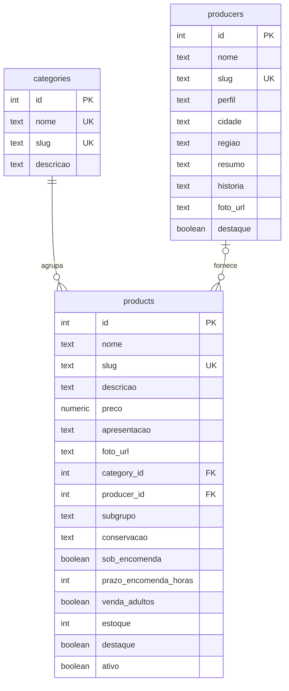

# Empório Gralha Azul — Modelagem do banco de dados

Este documento descreve as tabelas do banco (PostgreSQL, hospedado no Supabase), o que cada coluna guarda e como as tabelas se relacionam.

**Estado atual:** catálogo (categorias, produtores e produtos). As tabelas de usuários, carrinho e pedidos serão adicionadas em uma etapa posterior.

## Diagrama

**Como ler as ligações**
- Uma categoria tem **zero ou muitos** produtos; cada produto pertence a **exatamente uma** categoria.
- Um produtor tem **zero ou muitos** produtos; cada produto tem **zero ou um** produtor (kits e a Tábua Gralha Azul não têm produtor).

## Tabela `categories`

Guarda as linhas do catálogo (Pinhão & Araucária, Colônias, Padaria etc.).

| Coluna | Tipo | Obrigatória | Observação |
|---|---|---|---|
| `id` | inteiro | sim | Chave primária, gerada pelo banco |
| `nome` | texto | sim | Único |
| `slug` | texto | sim | Único; usado no endereço da página |
| `descricao` | texto | não | Frase de apresentação da linha |

## Tabela `producers`

Guarda os produtores parceiros (fictícios).

| Coluna | Tipo | Obrigatória | Observação |
|---|---|---|---|
| `id` | inteiro | sim | Chave primária |
| `nome` | texto | sim | |
| `slug` | texto | sim | Único |
| `perfil` | texto | não | Ex.: queijaria, apiário, ateliê de chocolate |
| `cidade` | texto | sim | |
| `regiao` | texto | sim | Usada no filtro da página Produtores Parceiros |
| `resumo` | texto | sim | Frase curta, para o card da lista |
| `historia` | texto | não | Texto longo, para a página do produtor |
| `foto_url` | texto | não | Endereço da foto |
| `destaque` | verdadeiro/falso | sim | Começa como falso |

## Tabela `products`

Guarda os produtos do catálogo.

| Coluna | Tipo | Obrigatória | Observação |
|---|---|---|---|
| `id` | inteiro | sim | Chave primária |
| `nome` | texto | sim | |
| `slug` | texto | sim | Único |
| `descricao` | texto | sim | |
| `preco` | numérico (2 casas decimais) | sim | `numeric`, para contas exatas com dinheiro |
| `apresentacao` | texto | sim | Ex.: "400g", "500ml", "pacote com 6" |
| `foto_url` | texto | não | Uma foto por produto (MVP) |
| `category_id` | inteiro | sim | Chave estrangeira para `categories` |
| `producer_id` | inteiro | não | Chave estrangeira para `producers`; vazio em kits e na Tábua |
| `subgrupo` | texto | não | Usado na Padaria (Pães, Cucas, Roscas & Doces) |
| `conservacao` | texto | sim | `ambiente`, `resfriado` ou `congelado` |
| `sob_encomenda` | verdadeiro/falso | sim | Começa como falso |
| `prazo_encomenda_horas` | inteiro | não | Antecedência necessária (ex.: 48) |
| `venda_adultos` | verdadeiro/falso | sim | Começa como falso; verdadeiro para cerveja, licor e bombom de licor |
| `estoque` | inteiro | sim | Nunca negativo |
| `destaque` | verdadeiro/falso | sim | Começa como falso |
| `ativo` | verdadeiro/falso | sim | Começa como verdadeiro; produtos saem de linha desativados, não apagados |

## Decisões de modelagem

- **Sem categorias dentro de categorias.** Os subgrupos da Padaria ficam no campo `subgrupo` do produto.
- **Preço como `numeric`.** Decimais comuns de computador cometem pequenos erros de arredondamento.
- **`ativo` em vez de apagar.** Preserva o histórico de pedidos e resolve a sazonalidade (linha de pinhão fora de abril a julho).
- **Kits e produtos "a partir de" são produtos comuns**, com o preço base e a lista de conteúdo na descrição.
- **Uma foto por produto e por produtor** no MVP.

## Próximas tabelas (a definir)

Usuários (integrados ao Supabase Auth), carrinho, pedidos e itens do pedido.
