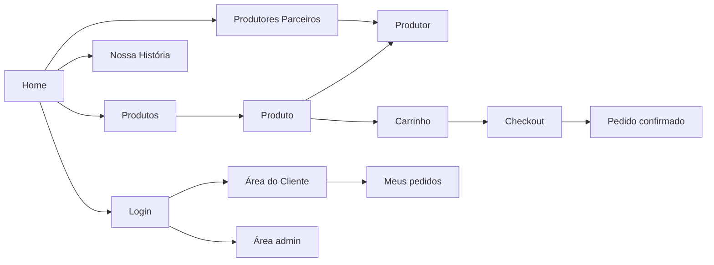

# Empório Gralha Azul — Estrutura do site e telas (MVP)

Este documento descreve o menu do site, o que cada página mostra e que dados e rotas da API ela usa. Serve de ponte entre o escopo, a modelagem do banco e o protótipo visual.

**Perfis de acesso:** Visitante (sem login) · Cliente (logado) · Administrador

## Menu principal

**Home · Produtos · Nossa História · Produtores Parceiros · Carrinho · Login / Área do Cliente**

---

## 1. Home
- **Acesso:** todos
- **Objetivo:** apresentar a loja e levar o visitante ao catálogo e às histórias por trás dos produtos.
- **Conteúdo:** banner com a identidade da loja, produtos em destaque, categorias, chamada para "Produtores Parceiros" (alguns produtores em destaque), trecho curto de "Nossa História", rodapé.
- **Dados:** produtos em destaque, categorias, produtores em destaque.
- **API:** `GET /products?destaque=true`, `GET /categories`, `GET /producers?limit=4`

## 2. Produtos (Catálogo)
- **Acesso:** todos
- **Conteúdo:** grade de produtos, busca por nome, filtros (categoria, produtor/região, faixa de preço), ordenação, paginação.
- **Dados por card:** foto, nome, preço, produtor, indicação de disponível/esgotado.
- **Estados:** carregando, sem resultados, erro.
- **API:** `GET /products?categoria=&produtor=&preco_min=&preco_max=&busca=&ordem=&pagina=`

### 2.1 Página do produto (abre ao clicar num produto)
- **Conteúdo:** fotos, nome, preço, descrição, categoria, produtor (com link para a página dele), estoque, quantidade, botão "Adicionar ao carrinho", produtos relacionados.
- **API:** `GET /products/{id}`

## 3. Nossa História
- **Acesso:** todos
- **Objetivo:** contar a origem da loja e dar identidade à marca (por que "Gralha Azul", valorização dos produtos do Paraná).
- **Conteúdo:** texto e imagens, valores da marca, linha do tempo opcional.
- **API:** nenhuma (página de conteúdo fixo). Será colocado um aviso de que a loja, os produtos e os produtores são fictícios (projeto de portfólio), com link para o GitHub.

## 4. Produtores Parceiros
- **Acesso:** todos
- **Objetivo:** dar rosto e região aos produtos, o grande diferencial do projeto.
- **Conteúdo:** lista de cards (foto, nome, cidade/região do Paraná, resumo), com filtro por região.
- **API:** `GET /producers?regiao=`

### 4.1 Página do produtor
- **Conteúdo:** foto, nome, cidade/região, história, lista dos produtos dele.
- **API:** `GET /producers/{id}`, `GET /products?produtor={id}`

## 5. Carrinho
- **Acesso:** cliente logado (?)
- **Conteúdo:** itens (foto, nome, preço, quantidade editável, subtotal), remover item, total, botão "Finalizar compra".
- **Estados:** carrinho vazio (com link para Produtos), item sem estoque suficiente.
- **API:** `GET /cart`, `POST /cart/items`, `PATCH /cart/items/{id}`, `DELETE /cart/items/{id}`

### 5.1 Finalizar compra (checkout, pagamento simulado)
- **Conteúdo:** resumo do pedido, endereço de entrega, pagamento simulado com aviso visível de demonstração, botão "Confirmar pedido".
- **Regra:** o back-end revalida o estoque e grava o preço de cada item no momento da compra.
- **API:** `POST /orders`

### 5.2 Pedido confirmado
- **Conteúdo:** mensagem de sucesso, número do pedido, resumo e total, link para "Meus pedidos".
- **API:** `GET /orders/{id}`

## 6. Login / Área do Cliente
- **Visitante vê:** formulário de login (com botão **"Entrar como visitante (demo)"**) e link para cadastro.
- **Cadastro:** nome, e-mail, senha e confirmação, com validação.
- **Cliente logado vê:** menu da área com **Meus pedidos** (lista e detalhes), **Meus dados** (nome, senha, endereço padrão) e **Sair**.
- **API:** `POST /auth/register`, `POST /auth/login`, `GET /orders`, `GET /orders/{id}`, `GET /users/me`, `PATCH /users/me`

---

## Área administrativa (fora do menu público)

O administrador não aparece no menu. É um usuário comum, marcado como "admin" no banco, que ao entrar vê uma área extra com estas telas:

- **Painel:** números principais (pedidos recentes, produtos com estoque baixo).
- **Produtos:** listar, criar, editar, ativar/desativar, com upload de foto.
- **Produtores e categorias:** listar, criar, editar.
- **Pedidos:** listar, ver detalhes e mudar o status (pendente → pago → enviado → entregue / cancelado).

**API:** `GET/POST/PATCH` em `/products`, `/producers`, `/categories`; `GET /admin/orders`; `PATCH /admin/orders/{id}/status`.

---

## Telas auxiliares

404 (página não encontrada) · 403 (sem permissão) · erro genérico / API fora do ar (inclui aviso de "servidor acordando" do plano gratuito do Supabase)

## Componentes reutilizáveis

Cabeçalho (logo, menu, contador do carrinho, entrar/conta) · Rodapé · Card de produto · Card de produtor · Filtros · Paginação · Seletor de quantidade · Botões · Campos de formulário com validação · Avisos (toast) · Indicador de carregamento · Tabelas do admin.

## Mapa de navegação

## Decisões em aberto

- Carrinho para quem não está logado: guardar no navegador e pedir login só no checkout, ou exigir login para adicionar?
- Produtos em destaque: campo `destaque` no produto ou critério automático (mais recentes)?
- Uma foto por produto ou várias?
- Quais status de pedido existem e quem pode mudá-los?
